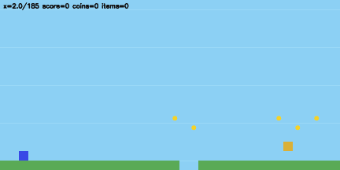

# EchoMario

[](https://github.com/fekoester/EchoMario/actions/workflows/tests.yml)
[](LICENSE)

**Can a fixed, random recurrent network control a platformer when only a linear readout is trained?**

EchoMario is a research codebase for frozen-reservoir control. A fixed echo state network
turns the screen into a rich dynamical state, and only a linear readout on top of it is trained. That
readout is trained either **by imitation** (ridge regression on a look-ahead planner's labels, with DAgger;
new in 0.3) or **by PPO**. The same PPO loop also runs a trainable **GRU**, a **CNN** and **linear**
baselines, so the frozen reservoir can be compared fairly against learned alternatives.

<p align="center">
  
  <br>
  <em>A frozen 3000-neuron reservoir with a ridge-regression readout (no reward, no backprop) finishing an
  unseen level with gaps, bridges and platforms. It finishes 55 % of unseen levels on this stage, against
  40 % for the best constant action and 0 % for a linear readout of the current frame.</em>
</p>

### Findings so far (0.3)

The full write-up is [docs/imitation.md](docs/imitation.md).

- **A frozen reservoir can learn to play when it is taught.** With ridge-regression readouts trained on a
  planner's labels, a 3000-neuron reservoir finishes 55 % of unseen gaps levels (84 % progress). A linear
  readout of the current frame, trained on the same data, finishes none. The reservoir's memory is what
  makes the difference.
- **Check results against the bunny-hop baseline.** Holding "right + run + jump" finishes 75 % of the stage-1
  levels (exactly the 0.2 demo's score), 40 % of gaps levels and 30 % of full levels. On the harder stages
  PPO converges to that policy. Use `scripts/constant_baselines.py` before reading any success rate.
- **Moving enemies are the open problem.** On stages with moving enemies, a linear readout of this reservoir
  does not yet beat the floor, even though the planner teacher finishes 85–95 % of those levels.

## Highlights

- **Original procedural platformer**: gaps, bridges, multi-floor platforms, moving enemies, coins,
  question blocks and items, with seeded train/eval levels. No ROMs or Nintendo assets are included.
- **Four agent families on one PPO loop**: frozen reservoir + readout, end-to-end GRU (truncated BPTT), tile-CNN and linear.
- **Imitation pipeline (0.3)**: a look-ahead planner teacher (95 % on full-difficulty levels), closed-form ridge
  readouts, DAgger, and offline comparison of feature maps on a recorded teacher dataset.
- **Reservoir options (0.3)**: local receptive-field input (`reservoir.input_structure: local`) and
  multi-timescale leaks (`reservoir.leak_rate_min/max`).
- **Gymnasium environments**: `gym.make("EchoMario/ToyPlatformer-v0")` works anywhere once `echomario` is installed.
- **Sweeps**: grid search over any config value, with multiple seeds and aggregated mean ± std tables.
- **Visual tooling**: videos with live reservoir panels, training-evolution videos, checkpoint sweeps and run comparisons.

## Installation

```bash
python -m venv .venv && . .venv/bin/activate
pip install -e ".[all]"        # core + video/plots (viz) + manual play (play)
# minimal headless install for training only:
pip install -e .
```

| extra | adds | needed for |
|---|---|---|
| `viz` | opencv (headless), matplotlib | `env.render()`, `record_video.py`, plotting scripts |
| `play` | pygame | `explore_toy_world.py`, `play.py` |
| `dev` | pytest, ruff, `viz` | running the tests |

**AMD GPUs without official ROCm support (e.g. RX 5700 / gfx1010).** Use torch 1.13.1 + ROCm 5.2 with
`HSA_OVERRIDE_GFX_VERSION=10.3.0`. torch 2.x ROCm wheels crash on most kernels on these cards.
[docs/imitation.md](docs/imitation.md#amd-gpu-rx-5700--gfx1010) has the exact setup.

## Quick start

**Use the environment on its own:**

```python
import gymnasium as gym
import echomario  # registers the environments

env = gym.make("EchoMario/ToyPlatformer-v0")          # continuous (move, jump, run) in [-1, 1]
obs, info = env.reset(seed=0)
obs, reward, terminated, truncated, info = env.step(env.action_space.sample())
```

| id | actions | level |
|---|---|---|
| `EchoMario/ToyPlatformer-v0` | continuous, 3-dim | full random level |
| `EchoMario/ToyPlatformerDiscrete-v0` | 8 discrete | full random level |
| `EchoMario/ToyPlatformerEasy-v0` | continuous, 3-dim | short level, no gaps/enemies |
| `EchoMario/ToyPlatformerEasyDiscrete-v0` | 8 discrete | short level, no gaps/enemies |

Every `ToyPlatformerEnv` argument can be passed through `gym.make` (e.g. `num_enemies=0`, `observation_mode="engineered"`).

**Train and compare agents:**

```bash
python scripts/train.py --config configs/toy_platformer_curriculum_stage1.yaml   # reservoir, easy level (~5 min CPU)
python scripts/train.py --config configs/toy_platformer_continuous.yaml          # reservoir, full level
python scripts/train.py --config configs/toy_platformer_continuous_gru.yaml      # trained GRU baseline
python scripts/train.py --config configs/toy_platformer_continuous_linear.yaml   # linear, no memory
python scripts/train.py --config configs/toy_platformer_continuous_cnn_parallel.yaml  # CNN, 128 parallel envs
```

**Watch and analyse:**

```bash
python scripts/play.py --checkpoint runs/toy_platformer_continuous_stable/best.pt
python scripts/record_video.py --checkpoint runs/<run>/best.pt --out outputs/agent.mp4 --level-seed 10001
python scripts/evaluate_checkpoints.py --checkpoint-dir runs/<run>/snapshots --csv-out outputs/eval.csv --plot-out outputs/eval.png
python scripts/plot_run_comparison.py --run-dirs runs/a runs/b --labels reservoir gru --out outputs/comparison.png
```

**Sweep reservoir hyperparameters:**

```bash
python scripts/sweep.py --config configs/toy_platformer_curriculum_stage1.yaml \
    --grid reservoir.size=200,400,800 --grid reservoir.spectral_radius=0.8,0.95 \
    --seeds 0,1,2 --total-steps 200000 --out-dir sweeps/stage1_reservoir
```

Each grid point and seed becomes a normal run directory, and finished runs are skipped on restart. The results go to
`results.csv` and to `summary.md`, a mean ± std table ranked by best eval return.

**Train a readout by imitation (0.3):**

```bash
python scripts/constant_baselines.py configs/imitation/gaps.yaml          # the floor to beat
python scripts/train_imitation.py --config configs/imitation/gaps.yaml --mode reservoir --target q --q-clip 5 \
    --critical-weight 4 --iters 4 --levels 20 --workers 2 \
    --set reservoir.input_structure=local --set reservoir.leak_rate_min=0.05 --set reservoir.leak_rate_max=1.0 \
    --out runs/imitation/gaps_res
python scripts/eval_readout.py runs/imitation/gaps_res --levels 40
python scripts/record_teacher.py --config configs/imitation/full.yaml --levels 40 --out runs/teacher/full.npz
python scripts/offline_readouts.py --config configs/imitation/full.yaml --data runs/teacher/full.npz --out runs/teacher/offline.json
```

## Models

| config | `reservoir.type` | `agent.model` | trained parameters |
|---|---|---|---|
| frozen reservoir | `sparse_esn` | `readout` (default) | linear policy + value readout only |
| trained recurrent | `none` | `gru` | encoder + GRU + heads |
| feed-forward | `none` | `readout` / `cnn` | linear / CNN actor-critic, no memory |

See [docs/architecture.md](docs/architecture.md) for the equations and PPO details.

Useful config keys added in 0.2:

| key | default | meaning |
|---|---|---|
| `reservoir.device` | `cpu` | run the reservoir input projection on `cuda` |
| `training.bootstrap_truncation` | `true` | bootstrap `V(s_T)` on time-limit truncation |
| `training.seq_len` | `64` | BPTT chunk length for recurrent policies |
| `agent.hidden_dim` / `agent.encoder_dim` | `256` | GRU sizes |

## Performance

On the main config (`toy_platformer_continuous.yaml`, 1200-node reservoir, 6491-dim tile observation), measured on 2 CPU cores:

| | v0.1 | v0.2 |
|---|---:|---:|
| reservoir step, 1 env | 1.65 ms | 0.51 ms |
| reservoir step, 8 envs | 5.9 ms | 2.1 ms |
| end-to-end training throughput | 418 steps/s | 745 steps/s |

The speedup comes from a sparse recurrent matrix and a sparse input projection for one-hot tile observations.
The results are numerically identical to the dense formula.

## Reproducibility

- Configs define deterministic evaluation seed ranges, so every checkpoint is scored on the same levels.
- Each run writes `eval_history.csv` / `.jsonl`, the best checkpoint and evolution snapshots.
- `pytest -q` covers the environment, Gymnasium compliance, the reservoir fast path, PPO correctness (raw-action
  log-probs, truncation bootstrapping, recurrent sequence re-evaluation) and runtime paths. CI runs it on Python 3.10, 3.12 and 3.13.

## Repository layout

```text
configs/                 training configs (incl. curriculum stages and the GRU baseline)
configs/imitation/       difficulty ladder for imitation (gaps, enemies, full, screen-only)
src/echomario/envs/      toy platformer, Gymnasium registration, optional Super Mario Bros wrapper
src/echomario/reservoirs sparse echo state network
src/echomario/agents/    readout, CNN and GRU actor-critics
src/echomario/training/  PPO, rollouts, evaluation, subprocess env pool
src/echomario/experts/   look-ahead planner teacher
src/echomario/imitation.py, teacher_data.py   ridge/DAgger readouts, recorded teacher datasets
scripts/                 train, sweep, play, evaluate, record, compare, imitation, baselines
tests/                   automated tests
docs/                    architecture, visualization and asset policy
```

## Documentation

- [Imitation readouts and 0.3 findings](docs/imitation.md)
- [Architecture](docs/architecture.md)
- [Visualization](docs/visualization.md)
- [Legal / Asset Policy](docs/legal.md)

## License

MIT (see [LICENSE](LICENSE)).
