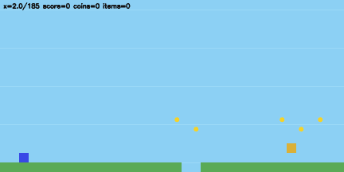
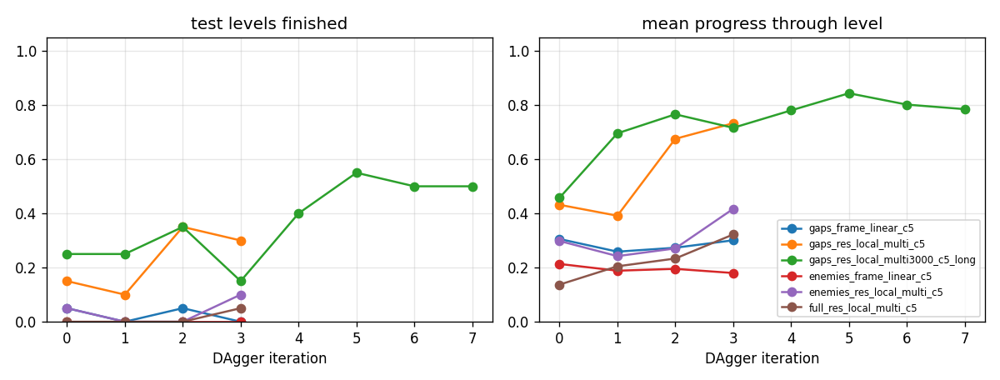
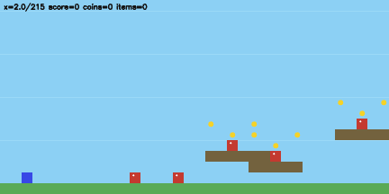

# Can a reservoir play? Imitation readouts (v0.3)

PPO on a frozen reservoir mixes two questions:

1. **Representation.** Is there a linear readout of the reservoir state that plays the game?
2. **Optimisation.** Can PPO find that readout from reward alone?

v0.3 answers the first question directly, in the classic reservoir-computing way. A teacher
labels the states, and the readout is fitted to those labels by ridge regression, in closed form
and in seconds. DAgger rounds then make the training data cover the states the student actually
reaches.

<p align="center">
  
  <br>
  <em>A frozen 3000-neuron reservoir (local receptive fields, multi-timescale leaks) with a
  ridge-regression readout, finishing an unseen level from the gaps stage. Nothing but the
  linear readout was trained, and the training took no reward signal.</em>
</p>

## Pipeline

| piece | file | what it does |
|---|---|---|
| teacher | `echomario/experts/planner.py` | Receding-horizon look-ahead planner. It clones the level, simulates 8 first actions × 4 follow-ups × 2 tails (3 + 14 + 14 frames) and scores each with reward minus a death penalty. It re-plans every 2 frames and finishes 95 % of full-difficulty test levels (100 % of gaps levels). |
| fast simulation | `envs/toy_platformer_env.py` | `get_sim_state` / `set_sim_state`, `compute_obs=False`, column-indexed collisions and an x-sorted coin index. Trajectories are bit-identical to v0.2 at about 1.7× the speed. |
| targets | `imitation.make_targets` | `q`: each action's planned score relative to the best one, clipped at `q_clip` points and mapped to [0, 1]. Also `onehot` and `graded`. |
| readout | `imitation.RidgeAccumulator` | Accumulates Gram matrices, solves ridge for several α, optionally upweights frames where some action is fatal (`--critical-weight`). |
| loop | `scripts/train_imitation.py` | Iteration 0 is pure expert data. Later iterations let the student drive with probability 1 − 0.5^i while the planner keeps labelling. α is picked by closed-loop success on validation levels. |
| offline study | `scripts/record_teacher.py`, `scripts/offline_readouts.py` | Records the planner once, then replays the observations through any feature map and scores its readout against the planner's action scores. |
| reservoir options | `reservoirs/esn.py` | `input_structure: local` (each neuron sees one random 5×5 tile patch; the camera follows the player, so a patch is a fixed offset from Mario) and `leak_rate_min/max` (multi-timescale, one leak per neuron). |

```bash
# record the teacher once, compare feature maps offline (minutes)
python scripts/record_teacher.py --config configs/imitation/full.yaml --levels 40 --workers 3 --out runs/teacher/full.npz
python scripts/offline_readouts.py --config configs/imitation/full.yaml --data runs/teacher/full.npz --out runs/teacher/full_offline.json

# closed-loop DAgger with the best feature map
python scripts/train_imitation.py --config configs/imitation/gaps.yaml --mode reservoir --target q --q-clip 5 \
    --critical-weight 4 --iters 4 --levels 20 --workers 2 \
    --set reservoir.input_structure=local --set reservoir.leak_rate_min=0.05 --set reservoir.leak_rate_max=1.0 \
    --out runs/imitation/gaps_res_local_multi
python scripts/eval_readout.py runs/imitation/gaps_res_local_multi --levels 40
python scripts/train.py --config <discrete config> --checkpoint runs/imitation/gaps_res_local_multi/best.pt  # PPO fine-tune
```

## Results

All results are on unseen, procedurally generated levels. Each readout sees the 18×36 tile screen
plus 11 state features, unless marked *screen only*. Results come from single seeds and 20–40
evaluation levels, so treat differences of under ~10 points as noise.

### First, the floor: a constant action

Holding **right + run + jump** the whole time ("bunny-hopping") finishes a large share of these
levels with no perception at all. Every success rate has to be read against that floor
(`scripts/constant_baselines.py`):

| stage | best constant action | finished | progress |
|---|---|---:|---:|
| v0.2 curriculum stage 1 | right_run_jump | **75 %** | 0.86 |
| gaps (`configs/imitation/gaps.yaml`) | right_run_jump | 40 % | 0.60 |
| gaps + slow enemies (`enemies.yaml`) | right_run_jump | 20 % | 0.55 |
| full difficulty (`full.yaml`) | right_run_jump | 30 % | 0.53 |

The v0.2 README's headline result ("finishes 75 % of the unseen evaluation levels" on stage 1)
is exactly what bunny-hopping scores on that stage.

### Closed loop on the 20 test levels (seeds 10000–10019)

| stage | teacher | constant run-jump | frame-linear + DAgger | reservoir 1200 + DAgger | reservoir 3000 + 8 DAgger rounds | PPO from scratch, 200–500k steps |
|---|---:|---:|---:|---:|---:|---:|
| gaps | 100 % | 40 % / 0.60 | 0 % / 0.30 | 35 % / 0.68 (40 % / 0.72 on 40 levels) | **55 % / 0.84** | 0–49 % (4 seeds, mean 30 %) |
| gaps + enemies | 85 % | 20 % / 0.55 | 0 % / 0.18 | 10 % / 0.42 | – | 11–20 % |
| full | 95 % | 30 % / 0.53 | 0 % / 0.13 † | 5 % / 0.32 | – | 30 % |

Cells show *finished / mean progress*. Reservoir rows use local input and multi-timescale leaks,
`q` targets with `q_clip=5` and `critical_weight=4`. PPO uses the same local multi-timescale
reservoir and logs "finished" only (mean of the last 5 evaluations). † from the earlier
`q_clip=30` run.



PPO details (`configs/ppo_ladder/*.yaml`; 8 envs, discrete actions, on the GPU):

- On gaps, the final success rates of 7 runs are 0, 0, 14, 32, 40, 41 and 49 %, with the local
  and dense layouts mixed. The result depends on the seed far more than on the layout.
- On gaps + enemies and on full, the runs end at or below the bunny-hop score (enemies: dense
  20 % flat, local 5–25 % noisy; full: both ~30 % flat) and stay there for hundreds of thousands
  of steps.
- Fine-tuning from the imitation readout (`--checkpoint best.pt`, zero value head) collapsed from
  50 % to 0 % within 140k steps.

### Offline: does the readout pick a fatal action? (full difficulty, 40 recorded levels, 10 held out)

`crit. fatal` is the fraction of *critical* frames (frames where at least one action is fatal) on
which the readout's greedy action is fatal within the planner's horizon. `good` is the fraction of
all frames on which the readout's action is within 0.5 points of the teacher's best plan.

| features | readout dim | good | crit. fatal |
|---|---:|---:|---:|
| frame-linear (no memory) | 6492 | 0.84 | 0.21 |
| reservoir, dense input (v0.2 layout) | 1201 | 0.88 | 0.20 |
| reservoir, **local input** | 1201 | 0.86 | 0.09 |
| reservoir, local input, multi-timescale | 1201 | 0.86 | 0.11 |
| reservoir, local input, multi-timescale, 3000 neurons | 3001 | 0.85 | 0.07 |
| screen only: frame-linear | 6481 | 0.80 | 0.18 |
| screen only: reservoir, dense | 1201 | 0.81 | 0.20 |
| screen only: reservoir, local, multi-timescale | 1201 | 0.74 | 0.20 |

Only 56 held-out frames are critical, so the crit. fatal column has a standard error of about
±0.05. α was picked on the test split here, which is optimistic. Use these numbers to rank
variants, not as final scores.

### How does the teacher play? How does the student?

Measured with `scripts/analyze_play_style.py` on 20 test levels per stage. "Reachable" means
at or before the farthest point the agent got to.

**Full difficulty:**

| | speedrunner teacher (default) | collector teacher (`--teacher-style collector`) | always run+jump |
|---|---:|---:|---:|
| levels finished | 95 % | 85 % | 30 % |
| killed by an enemy | 0 | 0 | 5 |
| enemies stomped | 169 of 316 reached (53 %) | 179 of 308 (58 %) | 18 (by accident) |
| coins taken (of reachable) | 54 % | 75 % | 41 % |
| ? blocks bumped | 18 % | 36 % | 1 % |
| mushrooms collected | 0 of 1 spawned | 3 of 14 spawned | 0 |
| speed when finishing (top run speed 9.9) | 8.1 tiles/s | 6.6 tiles/s | 8.4 tiles/s |
| button changes per second | 3.4 | 4.6 | 0 |

**Imitation student vs. speedrunner teacher (same 20 levels):**

| | gaps: teacher | gaps: student (3000 neurons) | enemies: teacher | enemies: student (1200) |
|---|---:|---:|---:|---:|
| coins taken | 26 % | 18 % | 51 % | 27 % |
| enemies stomped | – | – | 86 | 6 |
| killed by an enemy | – | – | 0 | 13 of 20 runs |
| speed when finishing | 6.9 tiles/s | 9.3 tiles/s | 6.9 tiles/s | 9.2 tiles/s |
| button changes per second | 4.3 | 1.3 | 5.0 | 1.4 |

The default teacher plays like a cautious speedrunner. It never dies to an enemy and stomps over
half of them, but its lookahead is about one second and coins (0.4), mushrooms (1.5) and stomps
(2.0) are tiny next to the 200-point death penalty. So it never detours for ? blocks or
power-ups, and it collects fewer coins on the gaps stage than bunny-hopping does.

The **collector** style adds planning-only bonuses (coin 1, ? block 6, mushroom 30, stomp 2). The
bonuses fade out over the last 30 % of the time limit. While a mushroom is out within 10 tiles,
the planner also looks further ahead (60-frame tail that may wait or walk left). This doubles the
? blocks hit and lifts coins to three quarters, at the cost of some finished levels and speed.
Mushrooms remain hard: one pops out on top of its block and creeps at 0.03 tiles/frame. Catching
it means stepping out, jumping onto the block and walking to it, a three-step move the planner's
tree does not contain. Speedrunner stays the default teacher, so the results above are unchanged.

The student copies the running and jumping, not the rest. It runs faster than its teacher, presses
fewer buttons, rarely stomps and takes fewer coins.

<p align="center">
  
  <br>
  <em>The speedrunner teacher on an unseen full-difficulty level: finishes, stomps 9 enemies,
  collects 26 coins and never touches a ? block.</em>
</p>

## What we learned

1. **Yes, a frozen reservoir with a linear readout can learn to play, but only when it is taught.**
   On the gaps stage, a ridge readout of a 3000-neuron reservoir finishes 55 % of unseen levels,
   with 84 % progress. That is clearly above the bunny-hop floor (40 % / 60 %) and the only
   learned agent here that is. It took no reward, no backprop and ~45k labelled frames.
2. **Memory is what the reservoir adds.** Fed the same data, a linear readout of the current frame
   never gets going (0 % finished, 30 % progress on gaps; 18 % progress with enemies). The
   reservoir's fading memory supplies velocity and phase-of-jump information that a single frame
   lacks.
3. **Input layout matters more than reservoir tricks.** Local receptive fields (each neuron sees a
   5×5 tile patch at a fixed offset from Mario) halve the readout's fatal choices on critical
   frames compared with v0.2's dense random projection (0.09 vs 0.20, offline on full levels).
   Multi-timescale leaks made no clear offline difference (0.11). Going from 1200 to 3000 neurons
   helped in closed loop on gaps (55 % vs 35–40 %), though single runs make that tentative.
4. **PPO on this setup mostly learns to bunny-hop.** Its plateaus match the constant run-jump
   policy to the percent. Imitation tells us a better readout exists (on gaps). PPO from reward
   alone does not find it reliably.
5. **Enemies are where it breaks.** With moving enemies, the readout must time jumps against a
   second moving object. On the enemies and full stages, 65–70 % of the imitation student's test
   episodes end in an enemy hit. The teacher handles them (85–95 %), so the limit is the linear readout
   of this reservoir, not the labels.

### Next steps worth trying

- **Make bunny-hopping fail.** Add a jump cost, low ceilings or enemies that punish constant
  jumping, so that success measures perception.
- **Fine-tune PPO from the imitation readout properly:** first fit the value head (ridge onto
  Monte-Carlo returns of the teacher episodes), then use a small learning rate or a KL penalty to
  the initial policy.
- **Grow the readout's input, not the reservoir.** Use quadratic features of a small set of
  reservoir states, or two reservoirs (fast/local + slow/global).
- **Test more seeds and levels.** Most cells here are single runs on 20 levels.

## Pitfalls found on the way

- **`enemy_pass_reward` never paid out (fixed in 0.3).** The pass test was
  `old_x <= enemy.x < new_x - 0.5`, which needs a step longer than 0.5 tiles, but the top speed
  is 0.33 tiles per step. It now fires when Mario's x crosses `enemy.x + 0.5`. Enemies carry a
  stable `uid`, so planner copies don't double-count. **Configs with `enemy_pass_reward > 0`
  (curriculum stages, CNN configs, `configs/imitation/*` derived from them) now actually receive
  that reward, so their old results are not directly comparable.** In this document that affects
  only the *gaps + enemies* stage (`enemy_pass_reward: 2.0`). All of its DAgger, PPO and
  play-style numbers were produced before the fix. Full difficulty and gaps use 0.
- **One-hot labels from a planner are a poor target.** The planner breaks near-ties between
  equally good actions by a fixed priority. The labels then look arbitrary to a linear readout:
  on full-difficulty levels the one-hot student finished 0 % and agreed with the teacher only
  ~70 % of the time.
- **The `q_clip` scale matters more than anything else.** With a clip of 30 points, idling
  (which costs ~1 point of progress per planning step) and running looked almost the same, and
  the student learned to stand still until the stall timeout (0 % finished on gaps). A clip of 5
  points fixed this (15 % → 35–40 % finished on gaps).
- **The teacher needs full-height jumps.** Raised bridges over wide gaps can only be reached with a
  full 13-frame jump hold. A 10-frame planning segment made the teacher walk under the bridge and
  fall (75 % → 95 % after the fix).
- **`.gitignore` excluded `*.gif`**, so the README's demo GIF was never committed. `docs/media/` is
  now exempt.

## AMD GPU (RX 5700 / gfx1010)

The RX 5700 is RDNA1 (gfx1010). Current ROCm PyTorch wheels do not ship kernels for it.
`HSA_OVERRIDE_GFX_VERSION=10.3.0` makes them load the gfx1030 kernels:

- **torch 2.2.2 + ROCm 5.7:** large matmuls work, but most other kernels (`randn` on device,
  reductions, `nn.Linear`, Adam) crash with *Memory access fault by GPU*. Unusable.
- **torch 1.13.1 + ROCm 5.2:** every kernel we use works and matches the CPU (relative matmul error
  3e-6, identical gradients). PPO training (`device: cuda`, `reservoir.device: cuda`) and the
  softmax readout fit (`fit=safe_ce,device=cuda` in `offline_readouts.py`) run on the GPU.

```bash
uv venv -p 3.10 .venv-rocm52
uv pip install -p .venv-rocm52/bin/python "torch==1.13.1+rocm5.2" --index-url https://download.pytorch.org/whl/rocm5.2
uv pip install -p .venv-rocm52/bin/python "numpy<2" scipy "gymnasium>=1.0" pyyaml tqdm pytest opencv-python-headless matplotlib
uv pip install -p .venv-rocm52/bin/python --no-deps -e .
HSA_OVERRIDE_GFX_VERSION=10.3.0 .venv-rocm52/bin/python scripts/train.py --config <config with device: cuda>
```

In this project the GPU matters less than the CPU. The environment is pure Python, and a
1200-neuron sparse reservoir step is cheap. The planner teacher is the expensive part (~12 ms per
frame), and it runs on CPU worker processes.
